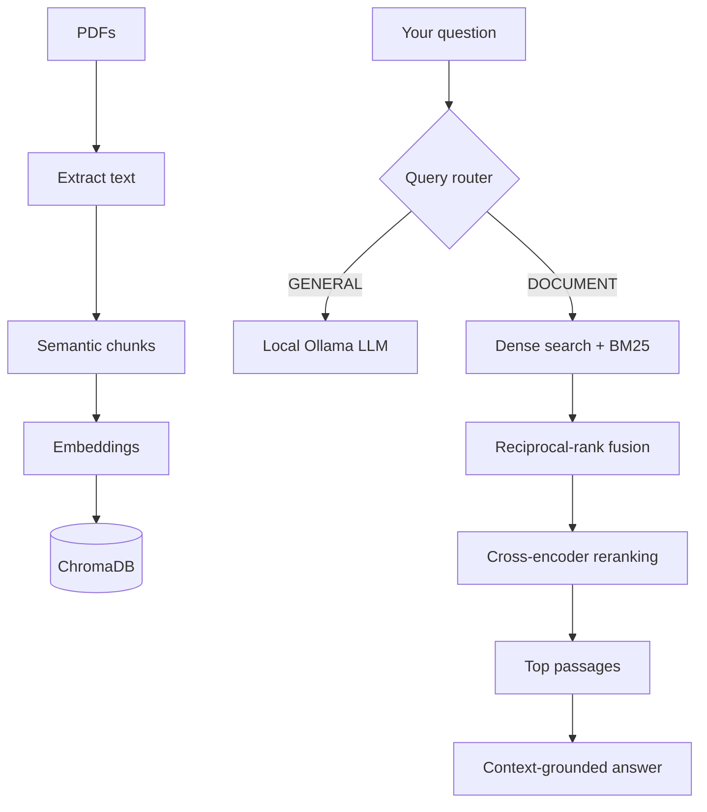

<div align="center">

# ⚡ CORE
### Contextual Omniscient Retrieval Engine

**Ask better questions. Find relevant context. Get grounded answers.**

A local-first RAG engine that routes questions intelligently and combines semantic search, keyword retrieval, and reranking to answer questions about your PDFs.

[Features](#-core-capabilities) · [How It Works](#-how-it-works) · [Quick Start](#-quick-start) · [Tech Stack](#-tech-stack)

</div>

---

## ✨ Why CORE?

Most basic RAG pipelines retrieve documents for every query. **CORE first decides whether your question needs your PDFs**—then uses a multi-stage retrieval pipeline when it does.

- 🧭 **Smart query routing** — separates document questions from general questions.
- 🔎 **Hybrid search** — combines semantic vector search with BM25 keyword retrieval.
- 🎯 **Reranking** — uses a cross-encoder to refine retrieved passages.
- 🧩 **Semantic chunking** — splits PDF content around meaning-related boundaries.
- 💾 **Persistent index** — stores vectors and document tracking locally.
- 🛡️ **Grounded-answer prompt** — tells the model to use retrieved context and admit when evidence is insufficient.
- 🖥️ **Local-first models** — uses Hugging Face embeddings and Ollama for local inference.

> CORE is designed to improve retrieval relevance and document-grounded answers. Its accuracy and performance have not yet been benchmarked against other RAG systems.

## 🚀 CORE Capabilities

| Capability | What it does |
|---|---|
| **Query routing** | Routes queries to `DOCUMENT` or `GENERAL` |
| **PDF ingestion** | Extracts text from PDFs with PyMuPDF |
| **Semantic chunking** | Uses embedding-aware boundaries |
| **Hybrid retrieval** | Combines dense search and BM25 |
| **Candidate fusion** | Combines retriever results with reciprocal-rank reranking |
| **Cross-encoder reranking** | Keeps up to 3 top passages from up to 10 candidates |
| **Source references** | Prints available filenames and page metadata |
| **Index maintenance** | Persists the index and attempts to remove deleted PDFs |

## 🔬 How It Works



**Two paths. One assistant.**

- **DOCUMENT:** retrieve, fuse, rerank, and answer from indexed PDF context.
- **GENERAL:** answer directly with the local Ollama model, without PDF retrieval.

## ⚡ Quick Start

### 1. Install dependencies

Create and activate a Python virtual environment, then install the packages used by the scripts:

```bash
pip install torch chromadb llama-index-core llama-index-embeddings-huggingface llama-index-readers-file llama-index-vector-stores-chroma llama-index-llms-ollama llama-index-retrievers-bm25 sentence-transformers pymupdf
```

### 2. Start Ollama

Install [Ollama](https://ollama.com/) and pull the configured model:

```bash
ollama pull qwen2.5-coder:1.5b
```

Make sure Ollama is running at `http://localhost:11434`.

### 3. Add your PDFs

Place PDF files in:

```text
storage/data/
```

### 4. Build the index

```bash
python Ingest.py
```

### 5. Ask questions

```bash
python Query.py
```

Example prompts:

```text
According to my PDF, what are the main findings?
Summarize the uploaded document.
Explain recursion with a simple Python example.
```

Type `exit` or `quit` to leave the console.

## 🧰 Tech Stack

| Component | Technology |
|---|---|
| Orchestration | [LlamaIndex](https://www.llamaindex.ai/) |
| Vector database | [ChromaDB](https://www.trychroma.com/) |
| Embeddings | `BAAI/bge-small-en-v1.5` |
| Keyword retrieval | BM25 |
| Reranker | `cross-encoder/ms-marco-MiniLM-L-6-v2` |
| Local LLM | [Ollama](https://ollama.com/) — `qwen2.5-coder:1.5b` |
| PDF parsing | PyMuPDF |
| ML runtime | PyTorch |

## 📁 Project Structure

```text
.
├── Ingest.py           # Ingest PDFs and build/update the index
├── Query.py            # Route questions and retrieve answers
└── storage/
    ├── data/           # Source PDFs
    ├── vectorDB/       # Persistent ChromaDB data
    └── docstore.json   # Document store and tracking
```

The scripts use paths relative to the directory from which they are run.

## ⚙️ Key Settings

- **Embedding model:** `BAAI/bge-small-en-v1.5`
- **Semantic split threshold:** `80`
- **Initial retrieval:** up to 10 candidates
- **Final reranked context:** up to 3 passages
- **LLM context window:** `3072`
- **LLM temperature:** `0.1`
- **Device:** CUDA when available; otherwise CPU

## ⚠️ Current Limitations

- PDF ingestion only; OCR and other file formats are not explicitly implemented.
- Query routing uses phrase cues and an LLM fallback, so misclassification is possible.
- Citation markers are generated by prompting and are not programmatically verified.
- Personal memory and conversation persistence are not implemented.
- Local execution does not automatically provide encryption, access control, or prompt-injection protection.
- No benchmark suite is included yet, so quality and speed claims remain unmeasured.

## 🛣️ What's Next?

- [ ] Evaluate retrieval quality and groundedness
- [ ] Test ingestion updates and deletion handling
- [ ] Validate citations against retrieved passages
- [ ] Improve query routing and document security
- [ ] Add OCR and broader file support

---

<div align="center">

**CORE — Context first. Evidence ranked. Answers grounded.**

Built for focused, local-first document retrieval.

</div>
